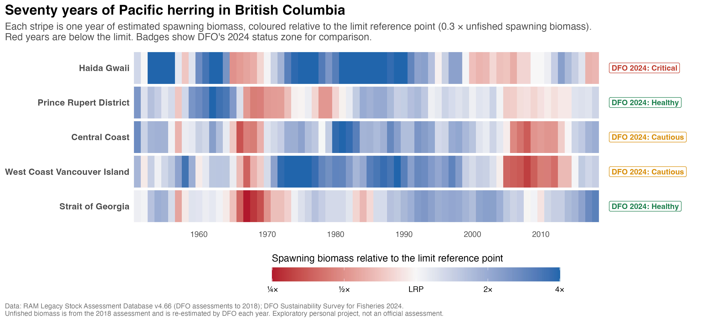

```{r}
#| label: setup
source(here::here("R", "functions.R"))
source(here::here("R", "plot_functions.R"))

stocks     <- readr::read_csv(here::here("data", "processed", "stocks.csv"), show_col_types = FALSE)
timeseries <- readr::read_csv(here::here("data", "processed", "timeseries.csv"), show_col_types = FALSE)
```

## Watch the Kobe plot unfold

A Kobe plot places a stock by its biomass (horizontal) and fishing pressure (vertical), both relative to the levels that would produce maximum sustainable yield (MSY). Green means more fish than the MSY level and less fishing than the MSY rate. Red means the opposite. Press **Play** to draw each stock's path year by year, or drag the slider.

Only sablefish and Pacific halibut have both ratios in the RAM Legacy database. Halibut fishing-pressure ratios are available for 2000 to 2013 only.

```{r}
#| label: kobe-animated
plot_kobe_animated(timeseries, stocks)
```

## Every assessed stock, year by year

Each tile is one year of estimated biomass relative to the stock's limit reference point. Red tiles are below the limit; blue tiles are above it. Hover over a tile for the value.

```{r}
#| label: stripes-interactive
st   <- stocks |> filter(!is.na(lrp_value))
lvls <- unname(stock_short[rev(st$stock_id)])

d <- timeseries |>
  filter(metric == "b_lrp") |>
  mutate(
    label = factor(unname(stock_short[stock_id]), levels = lvls),
    hover = as.character(glue("<b>{label}</b>, {year}<br>{number(value, accuracy = 0.01)}\u00d7 the limit reference point"))
  )

p <- ggplot(d, aes(year, label, fill = log2(value), text = hover)) +
  geom_tile(height = 0.9, width = 1) +
  fill_lrp() +
  labs(x = NULL, y = NULL) +
  theme_minimal(base_size = 12) +
  theme(panel.grid = element_blank(), legend.position = "none")

ggplotly(p, tooltip = "text", height = 460) |>
  config(displayModeBar = FALSE)
```

## Herring up close

{fig-alt="Stripes showing Pacific herring spawning biomass relative to the limit reference point for five BC areas, 1951 to 2018."}

Pacific herring is assessed separately in five major areas. All five show a low period in the late 1960s. The West Coast of Vancouver Island and the Central Coast had a second low period in the mid to late 2000s. Haida Gwaii spent most years after 2000 below its limit.