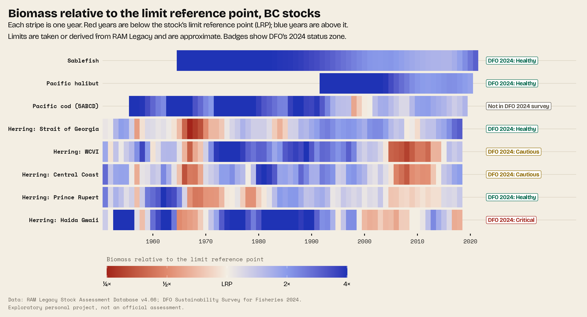

```{r}
#| label: setup
source(here::here("R", "functions.R"))
source(here::here("R", "plot_functions.R"))
source(here::here("R", "card_functions.R"))

db_dir     <- here::here("data", "processed")
stocks     <- readr::read_csv(file.path(db_dir, "stocks.csv"), show_col_types = FALSE)
timeseries <- readr::read_csv(file.path(db_dir, "timeseries.csv"), show_col_types = FALSE)
cards      <- make_card_data(stocks, timeseries)

both    <- cards |> filter(!is.na(latest_b_lrp), !is.na(dfo_status_zone))
agree   <- sum((both$latest_b_lrp < 1) == (both$dfo_status_zone == "Critical"))
n_below <- sum(cards$latest_b_lrp < 1, na.rm = TRUE)
yrs     <- range(timeseries$year[timeseries$metric == "b_lrp"])
```

::::: {.hero-full .column-screen style="background-image: url('figures/banner_stripes.png');"}

:::: {.hero-inner}

[Exploratory rapid assessment toolkit · R · Quarto · open data]{.eyebrow}

# Ten BC fish stocks. [Seventy years of evidence.]{.accent}

An open-data look at the status of ten British Columbia fish and shellfish stocks, how they have changed, and how much evidence sits behind each one.

[Explore the map](#map){.btn .btn-accent} [Read the story](story.qmd){.btn .btn-ghost}

[Background: average Pacific herring biomass relative to the limit reference point across five areas, one stripe per year, 1951 to 2018.]{.hero-note}

::::

<svg class="hero-wave" viewBox="0 0 1440 90" preserveAspectRatio="none" aria-hidden="true"><path d="M0,40 C240,90 480,0 720,30 C960,60 1200,10 1440,40 L1440,90 L0,90 Z" fill="#f6f4ef"/></svg>

:::::

```{r}
#| label: stats
div(
  class = "stat-row lift",
  div(class = "stat-box", div(class = "num", nrow(cards)),
      div(class = "lab", glue("stocks across {n_distinct(cards$species)} species"))),
  div(class = "stat-box", div(class = "num", sum(cards$data_tier != "D")),
      div(class = "lab", "with an assessment time series")),
  div(class = "stat-box", div(class = "num", diff(yrs) + 1),
      div(class = "lab", glue("years of biomass estimates ({yrs[1]} to {yrs[2]})"))),
  div(class = "stat-box", div(class = "num", glue("{agree}/{nrow(both)}")),
      div(class = "lab", "assessed stocks where the latest estimate agrees with DFO's 2024 zone")),
  div(class = "stat-box", div(class = "num", n_below),
      div(class = "lab", "stock below its limit reference point in its latest year"))
)
```

## Where the stocks are {#map}

```{r}
#| label: map
make_stock_map(cards, link_prefix = "stocks/")
```

## Seventy years in one picture

{fig-alt="Stripes showing biomass relative to the limit reference point for eight BC stocks from 1951 to 2021."}

Each row is a stock and each stripe is a year. Red years are below the stock's limit reference point, the level below which DFO considers serious harm to be occurring. Herring rows show a coast-wide low in the late 1960s and a second, later low on the West Coast of Vancouver Island and the Central Coast. Haida Gwaii herring is the one stock below its limit in its most recent year, which matches its Critical zone in DFO's 2024 survey.

## What this is, and what it is not

- It compiles public data from Fisheries and Oceans Canada (DFO) and the RAM Legacy Stock Assessment Database into one documented database.
- It applies simple, written-down rules to show status, trends, and data gaps for each stock.
- It is not an official assessment. It does not reproduce the methodology of any seafood recommendation program, and it makes no recommendations about what to buy or eat.
- Assessment time series end between 2018 and 2021, so they can lag DFO's latest advice.
