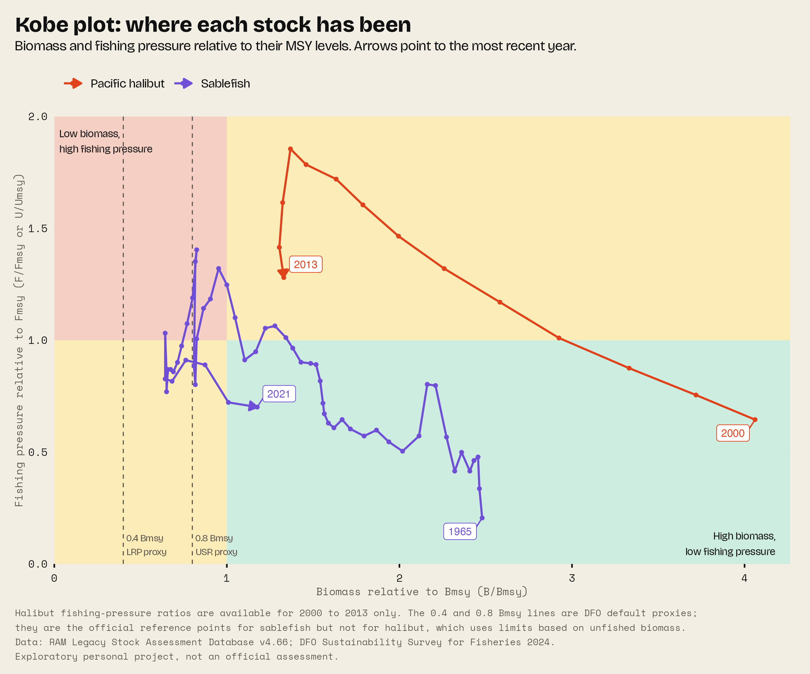
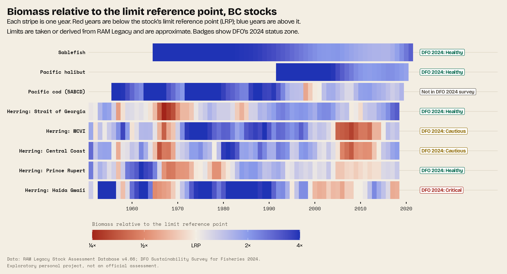
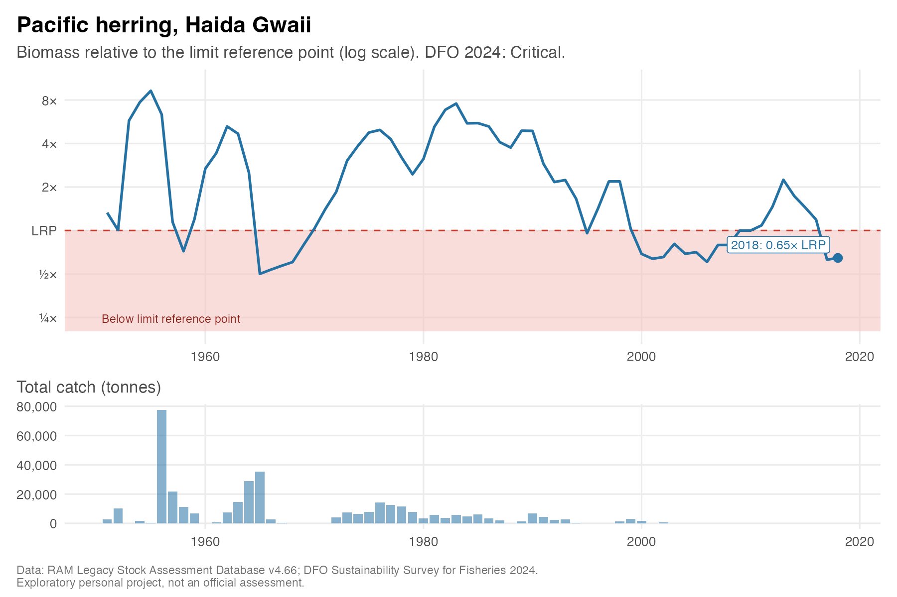

```{r}
#| label: setup
source(here::here("R", "functions.R"))
source(here::here("R", "plot_functions.R"))

stocks     <- readr::read_csv(here::here("data", "processed", "stocks.csv"), show_col_types = FALSE)
timeseries <- readr::read_csv(here::here("data", "processed", "timeseries.csv"), show_col_types = FALSE)
```

Scroll down. The chart on the right changes as you read.

:::{.cr-section}

Ten stocks, six species: sablefish, Pacific halibut, Pacific cod, Pacific herring in five areas, spot prawn, and Dungeness crab. @cr-evidence

Nine of them are in DFO's 2024 Sustainability Survey for Fisheries, which gives each an official status zone: Healthy, Cautious, or Critical. The dots on the right show those zones. Pacific cod is not in the 2024 survey. @cr-evidence

The evidence behind the zones varies a lot. Herring biomass estimates go back to 1951. Sablefish and halibut also have a measure of fishing pressure, shown by the thinner dark bars. @cr-evidence

Spot prawn and Dungeness crab have no public assessment time series compiled in this project. Their zones come entirely from DFO's survey response; for Dungeness crab, that response records expert judgement. @cr-evidence

:::{#cr-evidence}
```{r}
#| label: evidence-chart
#| fig-width: 9
#| fig-height: 6.2
lvls <- unname(stock_short[rev(stocks$stock_id)])

avail <- timeseries |>
  filter(metric %in% c("b_lrp", "u_umsy")) |>
  group_by(stock_id, metric) |>
  summarise(start = min(year), end = max(year), .groups = "drop") |>
  mutate(
    label = factor(unname(stock_short[stock_id]), levels = lvls),
    what  = if_else(metric == "b_lrp", "Biomass vs limit", "Fishing pressure vs MSY")
  )

zones <- stocks |>
  transmute(label = factor(unname(stock_short[stock_id]), levels = lvls),
            zone  = coalesce(dfo_status_zone, "Not in survey"))

nodata <- stocks |>
  filter(data_tier == "D") |>
  transmute(label = factor(unname(stock_short[stock_id]), levels = lvls))

ggplot() +
  geom_segment(data = avail,
               aes(x = start, xend = end, y = label, yend = label, colour = what, linewidth = what),
               lineend = "round") +
  scale_colour_manual(values = c("Biomass vs limit" = "#9db8d3", "Fishing pressure vs MSY" = "#1f4e79"), name = NULL) +
  scale_linewidth_manual(values = c("Biomass vs limit" = 6, "Fishing pressure vs MSY" = 2.2), name = NULL) +
  geom_point(data = zones, aes(x = 2024, y = label, fill = zone),
             shape = 21, size = 5, colour = "white", stroke = 1) +
  scale_fill_manual(values = zone_cols, name = "DFO 2024 zone") +
  geom_text(data = nodata, aes(x = 1987, y = label, label = "No public time series compiled"),
            colour = "grey45", size = 3.4, fontface = "italic") +
  scale_x_continuous(breaks = seq(1950, 2020, 10), limits = c(1948, 2027)) +
  labs(title = "What we know, and when",
       subtitle = "Bars show years with assessment data. Dots show DFO's 2024 status zone.",
       x = NULL, y = NULL, caption = caption_std) +
  theme_bcstock() +
  theme(legend.position = "bottom", panel.grid.major.y = element_blank())
```
:::

Only two stocks have both biomass and fishing pressure measured against their MSY levels, which is what a Kobe plot needs. @cr-kobe

For part of its history, sablefish sat in the red quadrant: biomass below its MSY level while fishing pressure was above the MSY rate. By 2021, the last year in the series, it was back in the green. [@cr-kobe]{scale-by="1.5" pan-to="20%,-10%"}

Halibut's fishing-pressure ratios cover 2000 to 2013 only. Over that period biomass fell from about four times its MSY level towards 1.3, while fishing pressure was above the MSY rate for most years. [@cr-kobe]{scale-by="1.5" pan-to="-20%,10%"}

:::{#cr-kobe}

:::

To compare all eight assessed stocks, each is measured against its own limit reference point: the level below which DFO considers serious harm to be occurring. Red years are below it. @cr-stripes

Herring in every area dropped below its limit in the late 1960s. [@cr-stripes]{scale-by="1.8" pan-to="25%,-20%"}

The West Coast of Vancouver Island and the Central Coast had a second low period in the mid to late 2000s. [@cr-stripes]{scale-by="1.8" pan-to="-25%,-10%"}

Haida Gwaii is the only stock below its limit in its latest year, 2018. DFO's 2024 survey places it in the Critical zone. [@cr-stripes]{scale-by="2" pan-to="-22%,-50%"}

Sablefish and halibut stayed above their limits throughout their series. Pacific cod dipped below its limit briefly in the late 1990s. @cr-stripes

:::{#cr-stripes}

:::

A closer look at Haida Gwaii herring. Estimated spawning biomass was below the limit for much of the period after 2000. @cr-hg

The bottom panel shows catch in the assessment series, which is close to zero for much of the same period. This project does not try to explain the pattern; the DFO assessment documents linked on the stock page do. @cr-hg

:::{#cr-hg}

:::

:::

## What this does and does not show

- It shows what public data say about ten BC stocks, and where those data run out.
- It does not reproduce DFO's methods or any seafood recommendation program, and it makes no recommendations.
- Assessment series end between 2018 and 2021, so they can lag DFO's latest advice.

[Open the map](index.qmd){.btn .btn-primary} [Browse the stock cards](cards.qmd){.btn .btn-outline-primary} [Read the methods](methods.qmd){.btn .btn-outline-primary}